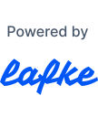

# Lafke brand kit


Official logos and usage guidelines for Lafke. Use the supplied files. Do not redraw or
typeset the logo.

## Logo

The logo is the `lafke` wordmark. Each file is an SVG with a transparent background.

| File                                                                             | Fill      | Use on                                 |
| -------------------------------------------------------------------------------- | --------- | -------------------------------------- |
| [`logos/wordmark-blue.svg`](logos/wordmark-blue.svg)                             | `#0057F5` | White or light backgrounds.            |
| [`logos/wordmark-blue-visualcenter.svg`](logos/wordmark-blue-visualcenter.svg)   | `#0057F5` | White or light backgrounds.            |
| [`logos/wordmark-white.svg`](logos/wordmark-white.svg)                           | `#FFFFFF` | Dark or brand blue backgrounds.        |
| [`logos/wordmark-white-visualcenter.svg`](logos/wordmark-white-visualcenter.svg) | `#FFFFFF` | Dark or brand blue backgrounds.        |
| [`logos/wordmark-black.svg`](logos/wordmark-black.svg)                           | `#000000` | One-color black. Prefer blue or white. |
| [`logos/wordmark-black-visualcenter.svg`](logos/wordmark-black-visualcenter.svg) | `#000000` | One-color black. Prefer blue or white. |

The `visualcenter` files are the Logo / Visual Center version. Align them with their
transparent bounds and scale them proportionally.

### Clear space and minimum size

| Rule         | Value                                                               |
| ------------ | ------------------------------------------------------------------- |
| Clear space  | `x = H / 4`, where `H` is the height of the wordmark, on all sides. |
| Minimum size | 120 px wide for digital use. Scale proportionally.                  |

Keep the clear space free of text and graphics. Measure it from the visible artwork, not
from the transparent bounds of the file. The 120 px minimum applies to the visible
wordmark.

### On imagery

- Do: place the logo on a quiet, dark area with room around it.
- Don't: place it on bright, detailed areas that hide it.

### Misuse

- Do not rotate the logo.
- Do not crop it.
- Do not recolor it. Use only the blue or white versions where you can.
- Do not reduce its contrast.

## Badges

Add a badge to your README or website to show that your project uses Lafke. Pick the
style that fits your page. Use the files as they are:

- Do not rotate the badges.
- Do not crop them.
- Do not recolor them.
- Do not reduce their contrast.

There are two badges, `powered-by` ("Powered by Lafke") and `scanned-by` ("Scanned by
Lafke"). Each comes in nine styles, as SVG and PNG, in [`badges/`](badges/).

| Style                | File suffix           | Looks like                                          | Use on             |
| -------------------- | --------------------- | --------------------------------------------------- | ------------------ |
| Default              | none                  | Blue badge with white text.                         | Any background.    |
| Dark                 | `-dark`               | Dark navy badge with white text.                    | Any background.    |
| Outline              | `-outline`            | White badge with a blue border.                     | Any background.    |
| Inline               | `-inline`             | Text and logo, no background.                       | Light backgrounds. |
| Inline, dark         | `-inline-dark`        | Light text and white logo, no background.           | Dark backgrounds.  |
| Stacked              | `-stacked`            | Text above the logo, no background.                 | Light backgrounds. |
| Stacked, dark        | `-stacked-dark`       | Light text above a white logo, no background.       | Dark backgrounds.  |
| Stacked, tight       | `-stacked-tight`      | Stacked, with no space on the left and right.       | Light backgrounds. |
| Stacked, tight, dark | `-stacked-tight-dark` | Stacked, dark, with no space on the left and right. | Dark backgrounds.  |

For example, `badges/powered-by-outline.svg` or `badges/scanned-by-stacked-dark.png`.

### Examples

| Style                | Powered by                                                                             | Scanned by                                                                             |
| -------------------- | -------------------------------------------------------------------------------------- | -------------------------------------------------------------------------------------- |
| Default              |                    |                    |
| Dark                 |               |               |
| Outline              |            |            |
| Inline               |             |             |
| Inline, dark         |        |        |
| Stacked              |            |            |
| Stacked, dark        |       |       |
| Stacked, tight       |       |       |
| Stacked, tight, dark |  |  |

The dark inline and stacked styles have white text and a white logo. They are meant
for dark backgrounds, so they are hard to see on a white page.

### Markdown

```md
[](https://lafke.dev)
```

### Light and dark themes

To switch between a light and a dark style with the reader's theme, use `<picture>`:

```html
<a href="https://lafke.dev">
  <picture>
    <source media="(prefers-color-scheme: dark)" srcset="https://raw.githubusercontent.com/lafke/brand-kit/main/badges/powered-by-inline-dark.svg">
    
  </picture>
</a>
```

## Naming and writing

| Form    | Use                                                   |
| ------- | ----------------------------------------------------- |
| `Lafke` | The official name, in prose.                          |
| `lafke` | The CLI, packages, domains and technical identifiers. |
| `LAFKE` | Only when the design context requires it.             |

Writing style: clear, factual, consistent.

- Use concise, straightforward English.
- Prefer active voice and short sentences.
- Avoid buzzwords, hype and unsupported security claims.
- Use the same terminology across all platforms.
